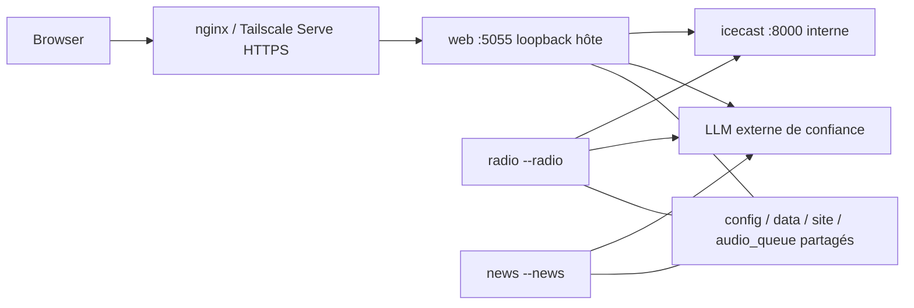

# Docker Compose — Sprint 02

Socle : `dev@f70ff2c`, PR #9 fusionnée explicitement après deux CI réussies.
Ce sprint prépare une installation neuve ; il n'a déployé, déplacé ou modifié aucune
donnée de l'installation existante. Linux Mint/Ubuntu avec Docker Engine local,
Python 3.12 et Compose v2 récent sont la cible. Pas de GPU ni modèle dans les images.

## Architecture et profils



| Service | Mode existant | Profil | Réseau / publication |
|---|---|---|---|
| web | `main.py --web` | web, full | backend + egress ; `127.0.0.1:5055` par défaut |
| news | `main.py --news` | news, full | backend + egress ; aucun port hôte |
| radio | `main.py --radio` | radio, full | backend + egress ; aucun port ; dépend d'Icecast healthy |
| icecast | Icecast 2.5.0 | radio, full | backend **internal** uniquement ; aucun port hôte |

Aucun service sans profil : `up` accidentel sans profil ne lance pas tout.
`--profile web up web` permet la consultation sans worker ni Icecast. La radio web
reste indisponible tant que le profil radio/full n'est pas démarré. Le profil full
active les quatre services ; il ne faut pas combiner d'autres lancements `--all`.
Les mounts restent `/nova` et `/nova-android`, accessibles via le proxy Flask
`/stream/…`. Les API Android ne changent pas. Pas de Docker socket, conteneur
privilégié, host networking, accès GPU ou service de modèle ajouté.

Les applications ont un réseau egress pour RSS/TTS et LLM explicitement configuré.
Icecast n'a pas d'egress ; le backend interne ne constitue pas une protection
contre un service déjà compromis. Les politiques HTTP/SSRF du Sprint 01B restent
actives pour les sources non fiables ; les serveurs LLM/Icecast de confiance sont
des origines explicitement configurées et distinctes.

## Images et versions

- Application : base officielle `python:3.12.14-slim-trixie`, digest
  `sha256:f77ac9e44ae96ef2c90b8053ea08c31f8be030f824196b0ae4db6d462c84e51f`.
- Icecast : base [LibreTime](https://github.com/libretime/icecast-docker)
  `libretime/icecast:2.5.0-debian`, digest
  `sha256:01b91f4d302775f761a5a23cd716586bf33574822d51a6667969c23165e5f286`.
  Tag maintenu déclaré par le projet, disponibilité et index public vérifiés au
  sprint ; index Icecast linux/amd64 et linux/arm64. L'ancienne image moul/latest
  n'est plus utilisée. Notre dérivé remplace son entrypoint et retire son XML à
  mots de passe d'exemple. Le binaire reste Icecast upstream fourni par LibreTime.
- Les PC Ryzen/i5 sont amd64, architecture CI testée. L'index arm64 existe mais
  l'installation complète n'y est pas testée ; pas de promesse pour ARMv7/32 bits.
- `requirements-runtime.lock` est le sous-ensemble runtime épinglé du lock testé.
  Pas de Playwright/pytest dans l'image. FFmpeg/FFprobe, Tini et tzdata proviennent de Debian. Le fuseau configuré et
  ses changements été/hiver restent disponibles sans montage de /etc/localtime.
  Les paquets OS suivent les mises à jour du dépôt trixie au build : le build n'est
  pas une reproduction bit à bit par snapshot apt. Conserver le digest de l'image
  **construite**, ses versions `dpkg-query`, et la référence Git pour rollback.

Les images locales ont des tags versionnés (`nova-atlas:02-foundation`,
`nova-atlas-icecast:2.5.0-02`), jamais latest. Aucune image applicative n'est publiée
automatiquement dans un registre. Pour un déploiement durable, construire puis
référencer un tag de commit ou digest conservé. Les digests de base figent aussi
leurs vulnérabilités éventuelles : mises à jour explicites et revalidation requises.

Le build copie une allowlist de code et fichiers de dépendances. Configurations
privées, `.env`, Git, plan local, musique, données, caches et sauvegardes restent
hors image. Aucun montage du home du développeur n'est utilisé.

## Installation neuve et initialisation

Installer Docker Engine et le plugin Compose selon la documentation officielle
[Ubuntu](https://docs.docker.com/engine/install/ubuntu/). Linux Mint est un dérivé :
utiliser sa base Ubuntu compatible et vérifier la procédure applicable ; ne pas
remplacer le codename Ubuntu par celui de Mint dans un dépôt apt. L'accès au daemon
Docker est un privilège d'administration de l'hôte. Ce sprint ne modifie ni groupes,
ni services Docker, ni installation en production. Compose v2.24+ et Engine avec
`host-gateway` sont nécessaires ; le client local vérifié était Compose v5.5.1.

Depuis le checkout approuvé, en utilisateur **non-root** qui possédera l'état :

```sh
python3.12 -m venv .venv-container
.venv-container/bin/python -m pip install -r requirements-runtime.lock
.venv-container/bin/python -m deploy.init \
  --directory deploy/local --admin-username atlas-owner \
  --llm-url http://host.docker.internal:8080 --model modele-deja-installe
```

Le mot de passe administrateur est demandé sans écho et confirmé (16 caractères
minimum). Le programme crée uniquement un **répertoire neuf**, refuse un existant,
et n'importe aucune donnée historique. Dans le checkout, seule la destination
ignorée `deploy/local` est admise ; un autre chemin doit être extérieur au checkout.
Utiliser un chemin simple sans espaces/métacaractères de fichier d'environnement.
Une erreur partielle laisse les fichiers créés pour inspection, sans écrasement
lors d'une relance. Choisir une nouvelle destination après examen.

Sans LLM, omettre URL et modèle pour un profil web seul ; les workers refusent de
partir tant qu'un endpoint et un modèle explicites ne sont pas configurés. Les
flashs ne produiront rien avant configuration LLM. Les feeds démarrent à `{}` :
aucune source ni collecte réelle n'est activée implicitement. Configurer les flux,
voix, heures et médias dans l'état neuf avant de démarrer les workers.

Le programme produit `compose.env` **sans credentials**, avec UID/GID du propriétaire
et chemin absolu de stockage. Toujours le passer explicitement : les anciens `.env`
du checkout ne sont pas la configuration du déploiement et ne doivent pas être chargés.

```sh
docker compose --env-file deploy/local/compose.env --profile full config --quiet
docker compose --env-file deploy/local/compose.env --profile full build
# Démarrage initial limité au web :
docker compose --env-file deploy/local/compose.env --profile web up -d --wait web
# Après revue de la configuration et autorisation de collecte/radio :
docker compose --env-file deploy/local/compose.env --profile full up -d --wait
```

Ne pas exécuter la dernière commande sur une installation existante sans sa propre
fenêtre de déploiement. Elle active effectivement RSS, LLM et TTS. Les commandes de
ce document n'ont pas été exécutées sur les données de l'utilisateur.

## Secrets et identités

`secrets/` est privé (0700), fichiers 0400 : identifiant admin, hash scrypt, secret
session, mot de passe source Icecast et XML Icecast. Les mots de passe source,
relay et admin Icecast sont générés séparément, en 256 bits aléatoires hexadécimaux.
Le compte source explicite est `source`, le compte admin Icecast `atlas-admin`.
Les secrets sont montés **en lecture seule et par rôle**, pas interpolés dans
Compose, passés dans des arguments de build ni stockés dans le YAML public.
Les fichiers locaux, dont `compose.env`, sont ignorés par Git au chemin géré.

Le Web charge les fichiers admin dans `ATLAS_ADMIN_USERNAME`,
`ATLAS_ADMIN_PASSWORD_HASH` et `ATLAS_SESSION_SECRET` avant exec. L'interface 01A est
conservée ; une autre installation Python peut continuer d'injecter ces variables
comme auparavant. Dans Compose, les fichiers sont la source d'autorité. Les valeurs
n'apparaissent pas dans `docker compose config` ou l'environnement déclaré de
l'image. Elles restent présentes dans la mémoire/environnement des processus
concernés ; l'administrateur Docker/hôte fait partie de la frontière de confiance.
FFmpeg reçoit son URL source en argv selon l'architecture existante : ne pas donner
l'accès aux processus de l'hôte à des comptes non fiables.

Précontrôles non-root, secrets obligatoires, permissions, chemins, ressource LLM et
stockage précèdent tout lancement. Aucune valeur d'exemple ou fallback silencieux
n'est accepté. Les erreurs sont génériques. Le log Android ne contient plus son
URL avec mot de passe. Mode debug non proposé par l'entrypoint de déploiement.

Rotation : préparer de nouveaux fichiers en privé, synchroniser le mot de passe
source dans XML **et** fichier source, arrêter puis redémarrer les services concernés.
Ne pas publier les XML, hashes ou logs contenant des informations privées. Le web
refuse les modifications des réglages Icecast gérés et du port web : leur rotation
se fait hors ligne dans l'état et Compose, sans faux succès sur un secret masqué.
Ne pas modifier les champs de chemins verrouillés. L'administration reste fermée
sans identité valide. Les credentials historiques d'une installation ancienne
nécessitent une rotation par son propriétaire ; cette PR ne les lit ni ne les change.

## Volumes, chemins et permissions

Tous sont des binds sous **le même répertoire d'état local**, aux cibles fixes `/app`.
Aucune création silencieuse de bind manquant par Docker (`create_host_path: false`).

| Sous-répertoire hôte | Cible | Lecteurs/écrivains |
|---|---|---|
| config | /app/config | Web RW, News/Radio RO ; YAML, feeds, bulletins, messages |
| data | /app/data | Web/News/Radio RW : articles, retries, éditions, rapports, posts, préférences, cache et verrous |
| site | /app/site | Web/News RW, Radio RO : exports et assets |
| audio_queue | /app/audio_queue | Web/Radio RW : MP3, reçus, staging et android_cache |
| music, background_music | /app/music, /app/background_music | Web/Radio RO ; médias fournis explicitement |
| logs/web, logs/news, logs/radio | /app/logs | RW seulement pour le rôle concerné ; nova.log redirigé dans ce volume |
| secrets | /run/secrets/* | RO, uniquement les fichiers requis par le rôle |

Racines de conteneurs RO ; seuls ces binds et tmpfs `/tmp`, `/app/tmp` sont écrits.
Pas de capacités Linux, no-new-privileges, UID/GID numérique commun. L'image a un
UID non-root 10001 par défaut ; `compose.env` le remplace par celui qui a créé l'état.
Ne pas oublier ce fichier, ni changer UID/GID pendant l'exploitation. Les fichiers
JSON, MP3 et reçus privés des sprints précédents sont alors lisibles par les trois
processus. La configuration radio historique fondée sur la racine du projet trouve
les mêmes `/app/data` et `/app/audio_queue` que les autres modes.

Identités partagées : `/app/data/ollama.lock`, `lock_resource: local-llm`, cache
`data/llm_cache`, `article-integrity.lock`, `article_processing.json` et le verrou de
publication dans `audio_queue`. Le cache Android et le staging sont sur le même
filesystem que leurs publications. Les nouvelles leases `service-web.lock`,
`service-news.lock`, `service-radio.lock` empêchent les doubles instances d'un mode,
y compris un scale accidentel. FDs conservés à travers exec/fork, libérés par l'OS.
**Ne jamais supprimer, remplacer ou déplacer les .lock en fonctionnement.**

Stockage POSIX local Linux uniquement. Les précontrôles refusent NFS/CIFS/SMB,
Ceph, 9p, virtiofs et FUSE connus ; ce filtre n'est pas une certification du stockage.
Tester sauvegarde/restauration sur le vrai FS. NFS/SMB, Docker Desktop, bind Windows,
volumes indépendants et coordination multi-hôtes ne sont pas supportés. Rootless ou
userns-remap nécessitent un mapping d'identités spécifique, non validé ici.

## LLM sur hôte ou machine de confiance

Dans un conteneur, localhost désigne **ce conteneur**, pas Linux Mint. Le nom
`host.docker.internal` est déclaré via `host-gateway`. Un serveur lié uniquement à
127.0.0.1 sur l'hôte ne sera pas accessible : configurer volontairement une écoute
sur une adresse précise du bridge hôte, avec pare-feu limité aux sources Docker
nécessaires, ou utiliser une machine distante via son IP Tailscale/LAN autorisée.
Ne pas ouvrir automatiquement le serveur sur 0.0.0.0 ni publier son port Internet.
Aucun changement de bind ou lancement de modèle n'est effectué par ce sprint.

Deux modes existants sont conservés :

- `llama-server` : URL de base du serveur llama.cpp existant, sans `/v1` final ;
  vérification TLS par défaut, aucun nouveau fournisseur cloud.
- `ollama` : l'appel actuel `ollama run MODELE` + stdin reste celui du moteur.
  L'image fournit un **adaptateur de déploiement minimal**, pas le CLI complet :
  il appelle uniquement `/api/generate` du serveur Ollama explicitement configuré,
  sans proxy implicite ni redirection, et refuse `pull`, `serve` et toute autre
  commande. Un modèle absent échoue ; aucune installation/pull automatique.
  Limites : prompt 256 000 caractères, réponse 1 Mio, timeout transport 1 200 s
  et timeout du subprocess existant. L'usage Python historique du vrai CLI n'est
  pas modifié. Configurer URL racine Ollama et nom d'un modèle déjà présent.

Autre possibilité, documentée par [Ollama](https://docs.ollama.com/api/openai-compatibility) :
son API locale compatible OpenAI peut utiliser le provider existant llama-server,
sans ajouter un backend. Aucun accès Ollama Cloud, OpenRouter ou LiteLLM implémenté.
Les limites LLM locales restent coordonnées par le même flock entre conteneurs.

## nginx, HTTPS et Tailscale

Le port web est lié à loopback ; utiliser nginx/Tailscale Serve sur l'hôte.
Conserver CSP, cookies, CSRF et proxy stream de [WEB_SECURITY.md](WEB_SECURITY.md).
Le proxy doit remplacer X-Forwarded-Proto par son schéma réel. En Docker, le pair
vu par Flask peut être **la passerelle du bridge**, pas 127.0.0.1. Inspecter le réseau
créé puis déclarer uniquement cette IP/pair exact en CIDR `/32` dans
`ATLAS_TRUSTED_PROXIES` ; ne pas faire confiance à tout le bridge ou à Tailscale.
Par défaut cette liste est vide, `ATLAS_COOKIE_SECURE=1` et HSTS est désactivé.

Pour un essai HTTP strictement local, l'opérateur peut choisir explicitement
`ATLAS_COOKIE_SECURE=0`, sans exposer le port ; préférer HTTPS pour l'administration.
`ATLAS_HSTS_MAX_AGE` ne s'active que pour un domaine HTTPS stable. Pas de changement
global du pare-feu, du proxy ou des services hôte exécuté par l'agent.

## Santé, arrêt et reprise

Healthcheck Web : PID superviseur, enfant vivant, stockage écrivable et HTTP
`/api/preferences`. News/Radio : superviseur/enfant vivants et stockage. Icecast :
HTTP local `status-json.xsl`. **Ni un processus vivant ni healthy ne prouvent une
collecte, génération LLM, TTS ou diffusion réussie.** L'absence de LLM/TTS n'est pas
un test de santé métier. Une dépendance unhealthy ne relance pas magiquement les
services : `unless-stopped` traite la sortie du processus, pas l'état health seul.
Consulter les journaux/états fonctionnels en complément. Logs Docker bornés 10 Mio ×3 ;
les nova.log persistants nécessitent une politique de rotation/archivage opérateur.
Icecast utilise un répertoire de travail privé `/tmp/icecast` (0700) et ses logs
accès/erreur vont sur stderr (`-`), capturés et bornés par Docker. Les noms de logs
sont relatifs à logdir dans Icecast : `/dev/null` ne désactive pas accesslog.

Tini PID1 transmet SIGTERM au superviseur existant, sans wrapper shell bloquant.
Les handlers sont installés avant les enfants ; une demande pendant leur démarrage
est différée jusqu'à leur enregistrement. Tous les modes ont un Event d'arrêt.
News/Radio drainent leurs tâches ; Web cesse d'admettre des requêtes, draine celles
acceptées et attend les flashs actifs. Les flux proxy observent l'Event, avec des
timeouts réseau/socket bornés. Aucun .lock n'est supprimé au stop.

```sh
docker compose --env-file deploy/local/compose.env --profile full stop
# Puis, sans reconstruire ni migrer :
docker compose --env-file deploy/local/compose.env --profile full up -d --wait
```

`ATLAS_STOP_GRACE=45m` par défaut (Icecast : 30 s), configurable avant démarrage.
La durée maximale d'un lot dépend des flux et timeouts cumulés ; 45 min n'est pas
une garantie universelle. Arrêter les admissions et observer les tâches avant une
maintenance ; augmenter le délai pour les lots longs. Une expiration provoque
**SIGKILL Docker**, qui n'est pas un arrêt normal : temporaires abandonnés et pertes
de travaux en mémoire restent possibles. Les écritures atomiques et journaux de
reprise précédents préservent les publications complètes, sans promesse exactly-once.
Le superviseur garde son watchdog ; les leases empêchent deux schedulers du même
mode, pas la duplication de travaux entre installations ayant des états séparés.

## Sauvegarde, restauration, mise à jour et rollback

1. Arrêter tous les services du projet et vérifier leur sortie ; ne pas copier un
   état actif en prétendant obtenir une sauvegarde cohérente.
2. Archiver **ensemble**, avec modes/UID/GID et sur support privé : config, data
   (cache, journaux, locks inclus), site, audio_queue (MP3 + reçus + cache Android),
   médias, secrets et compose.env. Les logs peuvent être archivés séparément.
3. Restaurer dans un répertoire local neuf. Adapter le chemin ATLAS_STORAGE et les
   UID/GID à la machine de destination, avec correction explicite des propriétaires
   hors fonctionnement si nécessaire. Secrets 0400, répertoires privés, formats
   historiques inchangés ; ne jamais effacer les anciens fichiers pour « réparer ».
4. Valider Compose avec le fichier env explicite ; démarrer d'abord Web, vérifier
   les lecteurs/permissions, puis activer les workers sur autorisation.
5. Mise à jour : conserver les anciennes images/digests et la sauvegarde, construire
   un nouveau tag de commit, mettre ATLAS_IMAGE/ATLAS_ICECAST_IMAGE à jour puis lancer
   `up -d --no-build --wait` après arrêt propre.
6. Rollback : arrêter, revenir aux tags/digests précédents et configurations
   compatibles, valider, redémarrer sans build. Restaurer une sauvegarde uniquement
   après comparaison/accord opérateur : elle pourrait effacer des publications
   plus récentes. Ne pas utiliser `down -v`, prune global ou suppression de locks.

Migration depuis Python : préparer l'état neuf, planifier l'arrêt coordonné de
**tous** les anciens processus, sauvegarder puis copier explicitement vers le nouvel
état les répertoires/fichiers listés. Remplacer les chemins/configuration par les
cibles `/app`, injecter des secrets renouvelés, conserver les hashes/journaux/reçus
et vérifier UID/modes. Ne jamais faire travailler ancien et nouveau groupe sur des
copies indépendantes d'un verrou pour la même ressource LLM. Cette procédure n'est
pas automatisée et n'a pas été exécutée sur l'installation de l'utilisateur.

## Validation et limites restantes

Tests unitaires sans daemon : structure/profils, `compose config` sur env synthétique,
secrets/perms, chemins/UID partagés, refus de stockages distants, singleton flock,
adaptateur Ollama simulé, healthchecks et SIGTERM d'un processus synthétique.
Les 866 tests existants et Chromium restent obligatoires. Quatre reproductions du
Compose ancien échouaient avant correction : services manquants, latest, identifiants
d'exemple, port wildcard. Elles vérifient désormais le comportement sûr.

La CI Docker utilise un projet et des données temporaires : build des deux images,
Web/Icecast uniquement, aucun moteur News/Radio réel. Elle vérifie FFmpeg/FFprobe,
refus de secrets absents, santé, fichier privé inter-conteneurs, concurrence flock,
MP3 sinusoïdal + reçu, SIGTERM, conservation d'inode et persistance après restart,
et absence des secrets synthétiques dans les logs. Les commandes News/Radio de
probe remplacent l'entrypoint par Python ; elles ne lancent pas les engines.

Le sandbox local refusait l'accès au daemon ; une vérification en lecture seule
hors sandbox a confirmé sa disponibilité. Seules des images de contrôle ont été
construites localement, sans lancer de pile ni modifier un service existant. Les
essais de démarrage/redémarrage sont réservés à la CI jetable. Pas de
preuve de diffusion réelle, de connectivité LLM/TTS ou de performance 24 h, ni de
test arm64. Le partage de fichiers et l'UID commun restent une frontière de confiance,
pas une isolation multi-utilisateurs. Rotation des caches/logs, capacité distribuée,
services SQL/LiteLLM et durcissement opérationnel ultérieur restent hors sprint.

## Extension optionnelle Sprint 03

`docker-compose.gateway.yml` ajoute le profil gateway (LiteLLM + relais de sortie).
Le Compose de base et ses profils restent utilisables seuls. Initialisation,
secret interne, mapping des cinq alias, capacités locales/cloud, réseaux, smoke
et rollback sont détaillés dans [LLM_GATEWAY.md](LLM_GATEWAY.md). Aucun cloud
n'est activé par défaut ; le relais partage le même data/UID que les apps.

## Extension optionnelle Sprint 04

`docker-compose.database.yml` ajoute database (PostgreSQL 18.6 épinglé, interne)
et database-tools (CLI explicite). Aucune application existante ne reçoit de secret
ou de dépendance DB ; LiteLLM reste sans DB. Nouveau stockage indépendant
ATLAS_STORAGE/postgresql, mêmes UID/GID, secrets privés et initialisation uniquement
sur chemins neufs. Aucun import/migration Alembic au démarrage. Installation,
pg_dump/restore et rollback : [DATABASE_MIGRATION.md](DATABASE_MIGRATION.md).

## Extension Sprint 05

feedparser et son dépendant sont épinglés dans l'image existante. Le fichier privé
feed_ingestion_state.json utilise le bind data commun ; pas de volume/service de
production supplémentaire ni changement PostgreSQL/LiteLLM. Le smoke RSS utilise
un conteneur jetable network=none et un transport de test injecté, jamais une
exception SSRF de production. Configuration/rollback : RSS_INGESTION.md.
