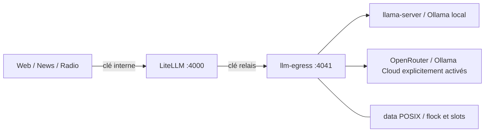

# Passerelle LLM — Sprint 03

## Architecture et garanties

Backend historique `ollama`/`llama-server` conservé. Backend `litellm` opt-in :



LiteLLM officiel **v1.108.0**, index public vérifié et épinglé dans
`deploy/Dockerfile.litellm` (amd64/arm64 ; CI amd64). Son image contient les
composants upstream ; aucun modèle téléchargé. Dérivé non-root, racine RO.
Les applications seules rejoignent `llm_clients`, LiteLLM et le relais seuls
`llm_transport`, deux réseaux internes. Aucun port publié. LiteLLM n'a **aucun
réseau egress** ; son unique destination modèle est le relais.

Le relais est un petit adaptateur Chat Completions, pas un second moteur LLM :
il impose la destination, le vrai modèle, la capacité et les secrets. Il ne relaie
ni URL, cookie, credential, header arbitraire ou message d'erreur fournisseur du
client. HTTP(S) vérifié, redirects interdits, proxies d'environnement ignorés,
requêtes/réponses bornées. Les URL de services sont de confiance, configurées par
l'opérateur ; la politique SSRF RSS ne leur est pas appliquée.

Le relais a un réseau egress : les destinations sont restreintes **par son code et
sa configuration**, pas par un firewall Docker L7. Un processus relais compromis
pourrait utiliser ce réseau. Restreindre aussi les sorties au niveau hôte si une
frontière réseau contre la compromission est exigée. Les backends historiques
et les autres fonctions applicatives gardent leurs besoins egress existants.

## Installation opt-in, sans cloud

Ne pas exécuter sur un état de production sans fenêtre de changement autorisée.
Partir de l'état neuf décrit dans DOCKER_DEPLOYMENT.md. Initialiser les seuls
nouveaux fichiers, sans écraser un existant :

```sh
.venv-container/bin/python -m deploy.gateway init --directory deploy/local \
  --model NOM_LOCAL_REEL --endpoint http://host.docker.internal:8080/v1
```

Cela ne démarre rien et ne change pas le backend. Les fichiers secrets sont privés,
le répertoire est celui de l'installation possédée par le même UID/GID. L'exemple
versionné est `config/llm_routes.yaml.example` ; son modèle est un placeholder,
pas une affirmation de disponibilité. Modifier explicitement le YAML de l'état :

```yaml
llm:
  provider: litellm
  model: atlas-fast
  base_url: http://litellm:4000
  gateway:
    policy: config/llm_routes.yaml
    prompt_version: legacy-v1
  # Conserver cache, lock_dir=data et lock_resource=local-llm existants.
```

Conserver les autres sections et chemins du fichier généré. Ne pas remplacer
config.yaml entier par cet extrait. Puis :

```sh
docker compose -f docker-compose.yml -f docker-compose.gateway.yml \
  --env-file deploy/local/compose.env --profile web --profile gateway config --quiet
docker compose -f docker-compose.yml -f docker-compose.gateway.yml \
  --env-file deploy/local/compose.env --profile web --profile gateway build
docker compose -f docker-compose.yml -f docker-compose.gateway.yml \
  --env-file deploy/local/compose.env --profile web --profile gateway up -d --wait
```

`--profile gateway` démarre proxy et relais ; ajouter `web`, `news`, `radio` ou
`full` selon les besoins autorisés. `full` seul dans le Compose historique ne
force pas LiteLLM. Utiliser les **mêmes fichiers/projet** pour stop/down/restart.
Aucune collecte réelle n'a été exécutée pour valider ce sprint.

## Alias et choix des modèles

| Caller / opération | Alias stable |
|---|---|
| fetch (résumé), posts | atlas-fast |
| fetch + operation=translate | atlas-translate |
| report, editions | atlas-editorial |
| bulletin, flash | atlas-radio-script |
| atlas, vérifications futures | atlas-verify |

Les prompts et langues ne sont pas réécrits. Les prompts existants continuent
d'utiliser la langue configurée ; la nouvelle opération distingue seulement la
traduction. L'ancien paramètre model des éditions ne contourne pas le routage ;
seul un des cinq alias explicites peut remplacer l'alias du caller.

`llm_routes.yaml` version 1 contient `deployments` et les cinq `aliases`. Chaque
alias liste un principal puis des alternatives **finies, uniques, explicites**,
`max_attempts` 1..4 **par destination**, timeout global <=3600 s. Un déploiement
contient provider, model réel, base_url, languages, max_input_chars et
max_output_tokens. Déclarer honnêtement les capacités : max_input_chars est une
borne de caractères conservatrice, **pas un calcul universel de tokens**. Aucun
fallback si la langue ou le volume déclaré n'est pas compatible ; pas de changement
de langue. Le format supporté est texte non-streamé, sans tools/images/JSON schema.

Ajouter un modèle : déclarer le déploiement, ses capacités et son coût autorisé,
puis l'ajouter à la liste d'un alias. Le retirer : retirer ses références puis sa
déclaration. Recharger/recréer **ensemble** les applications, le proxy et le relais
pendant une fenêtre où les travaux sont drainés : pas de hot reload coordonné.
LiteLLM reçoit un alias principal et des noms internes `alias--deployment` ; le
client ne lui demande jamais de choisir un modèle non configuré.

## Fournisseurs

- **llama-server** local/distant : endpoint OpenAI compatible avec suffixe `/v1`,
  nom réel du modèle chargé. Pas d'auto-détection/auto-démarrage via ce backend.
- **Ollama local** : provider `ollama`, endpoint `http://HOTE:11434/v1`, modèle déjà
  installé. Le client API ne lance ni pull ni serveur. Ne pas confondre le modèle
  local avec un alias cloud du daemon ; local_only ne peut pas attester ce que fait
  un serveur externe administré séparément. Contrôler sa configuration et ses sorties.
- **Ollama Cloud** : provider `ollama-cloud`, base_url imposée
  `https://ollama.com/v1`, clé officielle dans `secrets/ollama_cloud_key`.
- **OpenRouter** : provider `openrouter`, base_url imposée
  `https://openrouter.ai/api/v1`, clé dans `secrets/openrouter_key`.
  Le relais désactive `provider.allow_fallbacks` : pas de fournisseur alternatif
  implicite côté OpenRouter. Les alternatives Nova restent explicites.

Les deux clouds exigent `local_only: false`, `paid: true|false` explicite,
concurrency (1..16), rpm et modèles réellement accessibles. Un déploiement payant
exige en plus `allow_paid: true`. Aucun exemple n'invente de modèle cloud ni ne
promet un quota gratuit permanent. `paid: false` est une déclaration opérateur,
pas une vérification automatique des tarifs : mettre des limites côté fournisseur.
`local_only: true` refuse toute déclaration cloud, même inutilisée.

## Concurrence, erreurs, fallback et arrêt

Le relais garde le flock historique `data/ollama.lock` (resource local-llm) pendant
l'appel local. Plusieurs modèles sur le même serveur/GPU exclusif gardent cette
même identité. Les anciens appels directs qui partagent réellement data, UID et
resource sont coordonnés avec lui. Un conflit reçoit 429 sans préempter l'actif.
Le cache utilise un verrou **par identité de requête**, jamais un verrou global
cloud. Les slots cloud sont distincts par fournisseur, partagés par flock ; les
limites les plus basses déclarées pour ce fournisseur s'appliquent à tous ses alias.
Le singleton `llm-egress` empêche plusieurs relais pour le même data_dir. RPM est
un compteur mémoire de ce singleton (tentatives admises incluses), perdu au restart.
Pas de FIFO/équité stricte, pas de quota tokens/minute garanti : 429 et budgets
fournisseur restent nécessaires. Cloud indépendant d'un local occupé.

**Plusieurs machines** : flock ne protège que le même stockage POSIX local. Tous
les clients doivent passer par cette passerelle pour être coordonnés. Un appel
direct d'une autre machine/outil contourne la limite ; restreindre l'accès réseau
au serveur local. NFS/SMB ne résolvent pas cela. Un timeout réseau n'atteste pas
que le fournisseur a effectivement arrêté son calcul après déconnexion.

Un seul propriétaire des retries : client Nova ; LiteLLM router/SDK configurés à
zéro et fallbacks désactivés. 401/402/403/404 sont distingués et non réessayés sur
la même destination ; 429/5xx/timeout/réseau/réponse invalide ont un nombre borné.
Backoff exponentiel borné avec jitter ; Retry-After secondes ou date HTTP respecté
sans raccourcissement, même avant fallback. S'il dépasse le budget restant, refus.
Contexte trop grand et capacités incompatibles sont distingués. Une erreur finale
lève GatewayError typée dans l'adaptateur ; call/ollama_call gardent le retour
historique chaîne vide. Aucun message fournisseur brut transmis aux consommateurs.

Le budget monotone inclut attente de cache, retries et alternatives. Les timeouts
transport sont bornés par le restant, corps lus par morceaux sous deadline ; pas
de garantie temps réel des syscalls sur machine défaillante. Annulation avant appel,
pendant attente/backoff et après transport ; une requête HTTP active peut drainer
jusqu'au timeout, elle n'est pas tuée implicitement. Le relais conserve son bail
pendant ce drain. SIGTERM draine ses requêtes ; LiteLLM arrête son worker. Le délai
Docker configurable peut finir par SIGKILL : garder les limites de Sprint 02.

## Secrets, santé, métriques et absence de DB

Les clés sont exclusivement fichiers locaux 0400 ; parent 0700. Seule la clé
interne LiteLLM est montée dans les apps. LiteLLM lit master_key et llm_egress_key ;
seul le relais monte les clés cloud. Aucune clé navigateur, export ou YAML.
Master key = credential administrateur upstream : réserver aux processus de
confiance, ne pas la distribuer aux téléphones/utilisateurs. UI désactivée, aucun
port hôte ; aucune gestion de clés virtuelles, équipes, comptes, budgets DB ou
journal de dépenses SQL. Aucun DATABASE_URL, PostgreSQL ou Redis ajouté.

La santé du proxy utilise /health/liveliness, celle du relais son endpoint interne ;
aucune healthcheck n'appelle un modèle. Elle ne prouve ni disponibilité fournisseur,
ni crédit, ni bon contexte. Les logs Nova contiennent alias, identifiant configuré,
provider, durée, succès/code d'échec et tokens entiers disponibles. Coût estimé
**inconnu** ; ce n'est pas une dépense facturée. Pas de coût/quotas financiers
persistants : aucune promesse de plafond strict. Contrôler factures, crédits et
limites de compte côté fournisseur. Logs Docker bornés comme Sprint 02.

Pour tourner une clé : drainer, remplacer le fichier privé hors Git, conserver
owner/mode, recréer tous les consommateurs concernés (les secrets bind changés par
rename ne se rechargent pas tout seuls), vérifier puis révoquer l'ancienne côté
fournisseur. Ne jamais réutiliser la clé OpenRouter exposée historiquement ; sa
révocation et l'audit d'utilisation restent à effectuer/vérifier par le propriétaire.
Aucune révocation n'est prétendue par ce sprint.

## Cache, sauvegarde, dépannage et rollback

Ancien cache inchangé et non migré. Nouveau sous-répertoire gateway-v1 : JSON
atomique unique par prompt complet, alias, déploiement/modèle/configuration,
langue, version de prompt et tâche. Le hash du prompt fournit la signature de
contenu ; le cache_key historique active le cache mais ne remplace pas ce hash.
Le résultat note le déploiement effectif. Un fallback valide peut être réutilisé
sans régénérer le principal ; une modification des paramètres change l'identité.
TTL existant appliqué, écritures atomiques et verrou par clé, échecs non cachés.
Pas de suppression d'anciens résumés/articles. Cache contient du texte éditorial :
le sauvegarder et le protéger comme les données. Purge du sous-répertoire nouveau
à planifier par l'opérateur ; pas de croissance/cleanup automatique de ses locks.

Sauvegarder config, secrets et data à l'arrêt/drain comme Sprint 02, avec
permissions intactes. En cas d'erreur : vérifier profils/fichiers Compose, santé,
permissions, route effective, modèle installé/autorisé, secret requis, 429 et budget.
Ne pas activer les logs de prompts/verbose upstream en production pour déboguer.
Rollback : drainer toutes les apps et les deux services gateway, remettre provider
ollama/llama-server et l'URL/modèle historiques, lancer le Compose de base seul.
Ne pas supprimer les fichiers lock ; garder les caches et fichiers historiques.
Aucune migration de données ou rollback réel exécuté pendant ce sprint.

## Références et validation

[LiteLLM configuration](https://docs.litellm.ai/docs/proxy/configs),
[router](https://docs.litellm.ai/docs/routing),
[limites sans DB](https://docs.litellm.ai/docs/proxy/docker_quick_start),
[Ollama OpenAI compatible, local/cloud](https://docs.ollama.com/api/openai-compatibility),
[OpenRouter Chat Completions](https://openrouter.ai/docs/api_reference/overview).
Version/digest vérifiés au sprint ; ne pas remplacer par latest. Les mises à jour
upstream nécessitent revalidation, notamment auth, retries et absence de DB.
Tests unitaires sans réseau, Chromium historique, smoke Compose historique conservé.
Le smoke gateway CI utilise uniquement un faux fournisseur HTTP local jetable ;
aucun modèle, TTS, source RSS ni compte cloud réel contacté.
